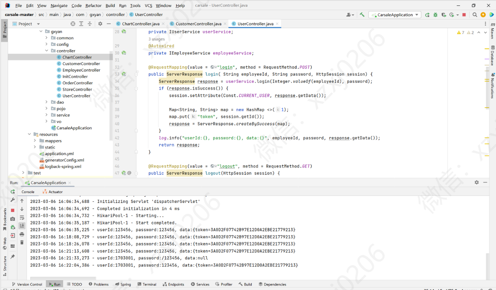
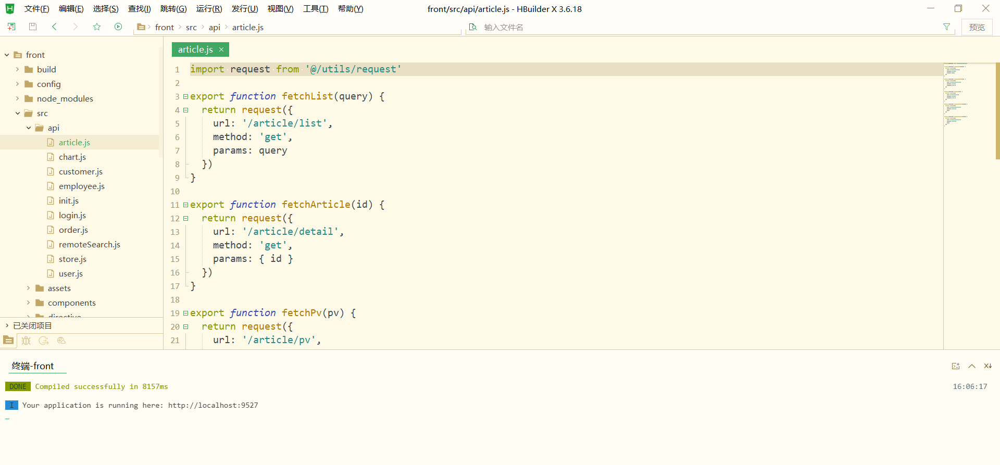
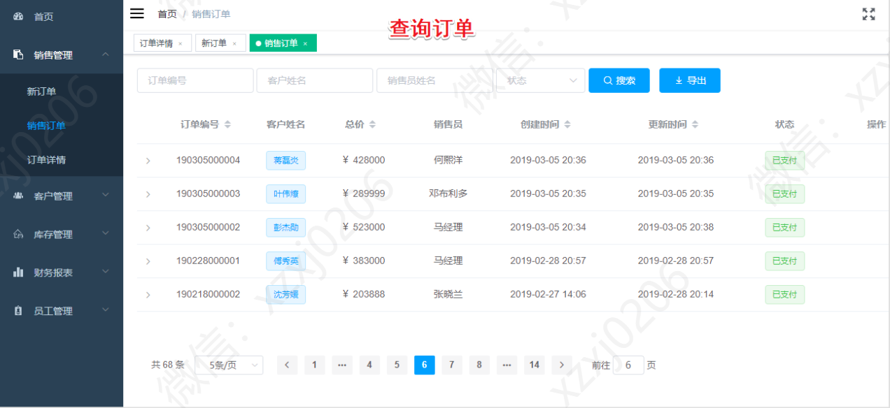
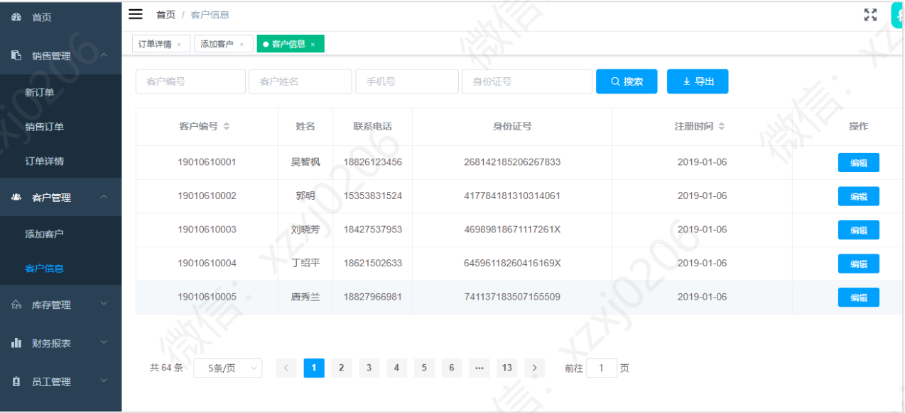
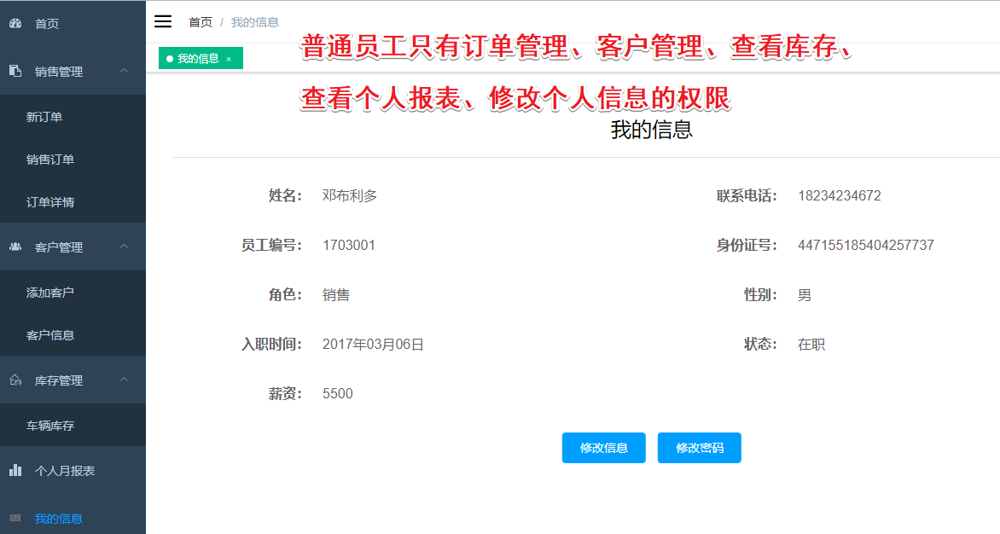
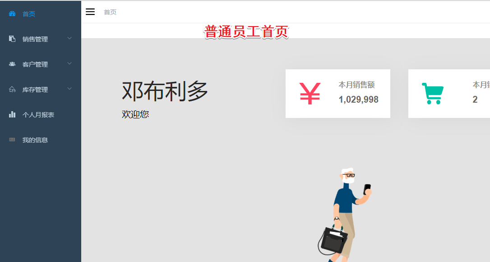
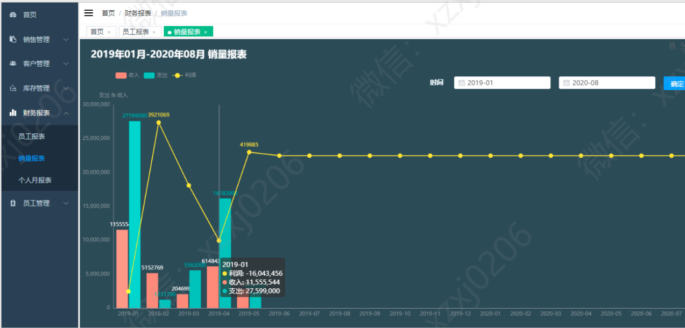
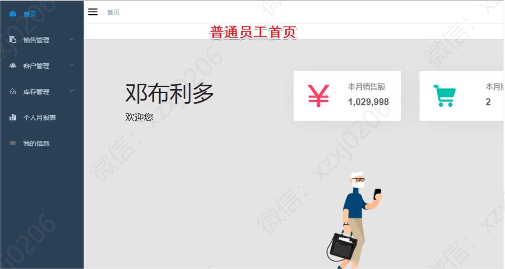
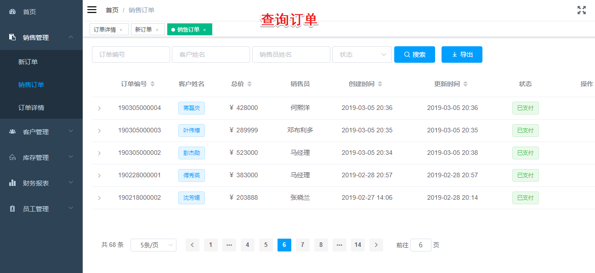
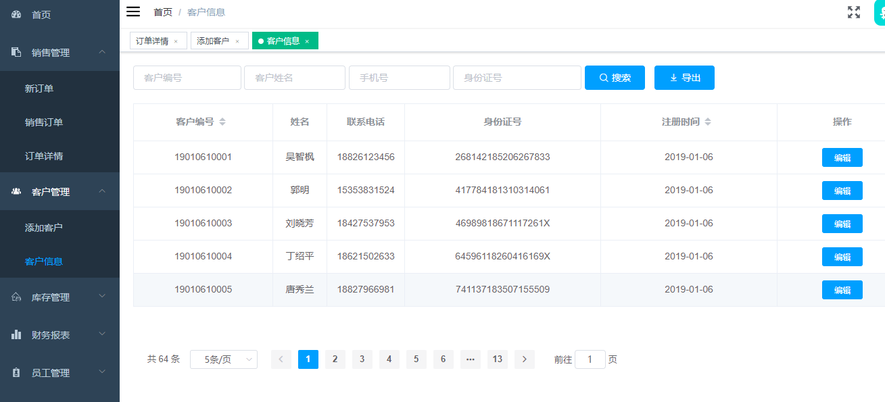

# 汽车销售管理系统

### 完整项目获取

通过网盘分享的文件：汽车销售管理系统

链接: https://pan.baidu.com/s/11JQUjFq6A5lkxrWId0D0TQ?pwd=xg6w 提取码: xg6w --来自百度网盘超级会员v3的分享

通过网盘分享的文件：工具包

链接: https://pan.baidu.com/s/1YmdoJvkjoUjA75wvHLDZ6A?pwd=xm96 提取码: xm96
--来自百度网盘超级会员v3的分享

需要远程项目部署或项目修改和毕业设计也可联系（添加申请时请备注好来意）

通过网盘分享的文件：远程调试部署联系方式

链接: https://pan.baidu.com/s/1W0dDcoZmayG0c7USJDYBYg?pwd=nqd7 提取码: nqd7
--来自百度网盘超级会员v3的分享

### 项目合集(项目不断更新中)
链接: https://pan.baidu.com/s/1nY-zhvAK0CXYcn3g7LzQnQ?pwd=id3c 提取码: id3c
--来自百度网盘超级会员v3的分享

#### 这些项目一起发你了 可以分享给你需要的同学 调试可找我 也接二次修改和项目定制、毕业设计等

## 接毕业设计和论文

微信联系方式：xzxj0206  QQ：3808981644   (支持修改、 部署调试、 支持代做毕设)

接网站建设、小程序、H5、APP、各种系统等，单片机、嵌入式也可以做

选题+开题报告+任务书+程序定制+安装调试+论文+答辩ppt  都可以做

## 一、介绍

### 基于springboot+VUE的汽车销售管理系统

针对汽车销售提供客户信息、车辆信息、订单信息、销售人员管理、财务报表等功能，提供经理和销售两种角色进行管理。

## 二、项目功能介绍

### 1、销售人员功能模块介绍

1、本月销售额统计 2、本月销量统计 3、销售管理(新订单、销售订单、订单详情) 4、客户管理(添加客户、客户信息) 5、库存管理 6、个人月报 7、个人信息

### 2、管理人员功能模块介绍

1、本月销售额统计 2、本月销量统计 3、销售管理(新订单、销售订单、订单详情) 4、客户管理(添加客户、客户信息) 5、库存管理(添加库存、车辆库存) 6、财务报表(员工报表、销量报表、个人月报表) 
7、员工管理(添加员工，员工信息)

### 3、系统运行界面

### 后端运行界面

### 前端运行界面

## 三、管理人员功能模块部分页面展示

## 四、销售人员功能模块部分页面展示

